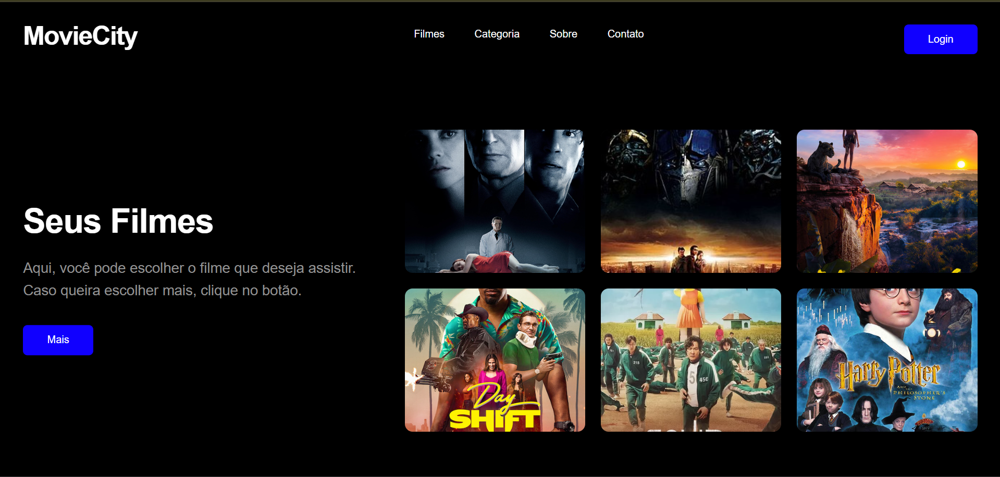

<div align="center">

# 🎬 MovieCity

### `YOUR NEXT MOVIE STARTS HERE.`

Uma experiência cinematográfica para explorar filmes e descobrir novas histórias.

<br/>


<br/>

**[🎥 Explorar projeto](#-sobre-o-projeto) · [⚙️ Instalação](#-como-executar) · [📁 Estrutura](#-estrutura-do-projeto)**

</div>

---

## 🍿 Sobre o projeto

O **MovieCity** é uma landing page desenvolvida para apresentar uma seleção de filmes em uma interface moderna, minimalista e inspirada no universo do cinema.

Com fundo preto, tipografia marcante, botões azuis e pôsteres em destaque, o projeto busca proporcionar uma experiência visual imersiva e intuitiva.

> *Grandes histórias merecem uma grande tela.*

## 🎞️ Preview

<div align="center">

<p align="center">
  
</p>

**Uma interface simples. Uma experiência cinematográfica.**

</div>

## ✨ Funcionalidades

| Recurso | Descrição |
|---|---|
| 🎬 Galeria de filmes | Exibição de seis pôsteres |
| 🧭 Navegação | Cabeçalho com links para as seções |
| 📱 Responsividade | Layout adaptável a diferentes telas |
| ☰ Menu mobile | Menu hambúrguer em telas pequenas |
| 🎨 Design | Tema escuro com detalhes em azul |
| ⚡ Vite | Ambiente de desenvolvimento rápido |

## 🖥️ Tecnologias

<div align="center">


</div>

- **React:** criação de componentes reutilizáveis.
- **Vite:** desenvolvimento e compilação do projeto.
- **JavaScript:** lógica e interatividade.
- **CSS3:** estilização e responsividade.
- **HTML5:** estrutura da página.
- **Node.js e npm:** execução e gerenciamento de dependências.

## 🎥 Filmes em destaque

<div align="center">

| | | |
|:---:|:---:|:---:|
| **Afterlife** | **Transformers** | **Mowgli** |
| **Day Shift** | **Squid Game** | **Harry Potter** |

</div>

## 📁 Estrutura do projeto

```text
landing_page_filmes/
├── 01_landingpage/
│   ├── public/
│   │   └── imagens/
│   ├── src/
│   │   ├── assets/
│   │   ├── components/
│   │   │   ├── Header.jsx
│   │   │   ├── Main.jsx
│   │   │   └── Home.jsx
│   │   ├── App.css
│   │   ├── App.jsx
│   │   ├── index.css
│   │   └── main.jsx
│   ├── index.html
│   ├── package.json
│   └── vite.config.js
├── Landing_Page.png
└── README.md
```

## ⚙️ Como executar

### 1. Pré-requisitos

- [Node.js](https://nodejs.org/) instalado.
- npm disponível no terminal.

### 2. Acessar a pasta do projeto

```bash
cd 01_landingpage
```

### 3. Instalar as dependências

```bash
npm install
```

### 4. Iniciar o servidor

```bash
npm run dev
```

### 5. Abrir no navegador

Acesse o endereço apresentado no terminal, geralmente:

```text
http://localhost:5173/
```

## 🧪 Verificação

Execute os comandos abaixo na pasta `01_landingpage`:

```bash
npm run lint
```

```bash
npm run build
```

O primeiro verifica problemas de lint e o segundo testa a compilação para produção.

## 🎞️ Uma dose de cinema no README

<div align="center">


*Lights. Camera. Code.*

</div>

## 🎯 Objetivo acadêmico

Aplicar conhecimentos de desenvolvimento front-end por meio da construção de uma landing page, trabalhando com componentes React, estilização CSS, organização de arquivos e adaptação para dispositivos móveis.

---

<div align="center">

### 🎬 MOVIECITY

**Desenvolvido com dedicação e muito código.**

`React` · `Vite` · `JavaScript` · `CSS`

<sub>Uma página. Muitas histórias. Um universo de possibilidades.</sub>

</div>

<div align="center">
<sub>Feito com 💙 por Alana Corso</sub>
</div>
